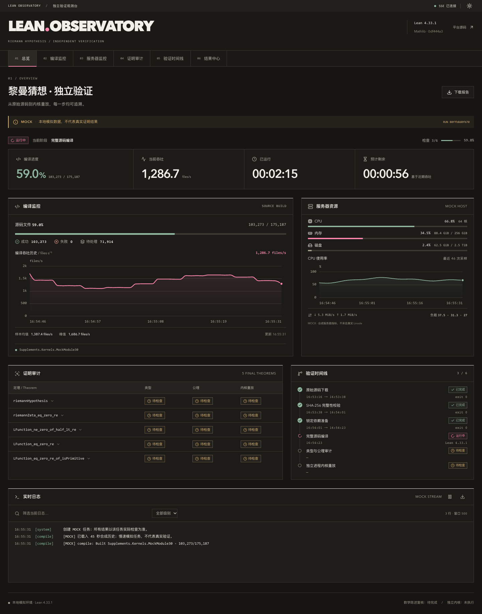

# Lean Observatory · 黎曼验证观测台

黎曼猜想 Lean 源码独立复现、审计与实时观测平台。React/TypeScript Dashboard + Python API/独立 Worker + SQLite WAL + Docker Compose/Nginx。

**真实项目验证未开始，未宣告证明成立。** 服务器尚未购买，计划域名 `lean.tano.asia`。本地验收与边界见 [验收报告](reports/LOCAL_QA.md)、[机器可读门禁](reports/local-acceptance.json)、[执行状态](reports/STATUS.md)。



## 功能

- 六个视图：验证总览、编译监控、服务器监控、证明审计、时间线、结果中心。
- 参考 bandori.fans 的暖白/暖黑编辑式主题，横向导航、320px 起响应式布局。
- D3 时间曲线、读数浮层、键盘/触控、下载/上传双曲线，过期/断线/缺测明确标识。
- 纯展示 Web：仅 GET/SSE/下载，所有任务写入接口返回 405；无账号、密码或管理员入口。
- SSE/心跳/断线重连、日志筛选与完整导出。
- Mock 成功、失败、中断、资源不足、暂停/恢复；数据与报告始终注明 MOCK。
- 持久化队列、阶段与实际命令退出码；独立 Web/Worker 限额、宿主机指标 agent。
- 原始 14 分卷与 gzip/字节数/SHA-256 校验；Lean v4.33.1 / Mathlib 锁定；完整源码编译、五个定理精确类型和公理审计、`leanchecker --fresh Main`。
- 正式执行在私有 PID/挂载/网络命名空间及降权 chroot 中进行；不可写工具链/原始源码，不可访问验证数据库或管理令牌。

## 本地启动

需要 Node 24+、Python 3.12+。本地原生服务只启用 Mock；正式 Lean Worker 使用 Linux 容器。

```sh
npm ci
npm run build
python3 scripts/local.py --demo --port 8787
# 打开 http://127.0.0.1:8787
```

```sh
npm test                 # 后端 + 图表计算 + TypeScript/构建 + Playwright 浏览器
npm run test:unit        # 后端/安全/恢复/门禁
npm run test:e2e         # 已构建后的浏览器测试
```

若没有浏览器，先 `npx playwright install chromium`；或设置 `CHROMIUM_PATH`。无 Browser 插件时使用实际 Playwright Chromium 进行桌面/移动端验收。

## Compose

复制 `.env.example` 为 `.env`，保持 `ENABLE_REAL=0`：

```sh
docker compose --profile mock up -d --build --wait
# 本地只读页面 http://127.0.0.1:8789
```

任务只通过宿主机/容器命令行管理，不向浏览器暴露控制接口：

```sh
# 本地原生模式
python3 -m backend.control --data .data create --mode mock --scenario success
python3 -m backend.control --data .data list
python3 -m backend.control --data .data pause RUN_ID
python3 -m backend.control --data .data resume RUN_ID
python3 -m backend.control --data .data cancel RUN_ID

# Compose Mock 模式，命令只在本机执行
docker compose exec mock-worker python3 -m backend.control --data /data create --mode mock
```

真实 Worker 为 `verification` profile；本机小样例需叠加 `compose.smoke.yaml`，不使用 64 核服务器的默认 cpuset/内存配置。不要同时启动两个 profile 的 Worker。两个持久卷分别存放不可被 Lean 子进程访问的证据与隔离构建输出。

## 顺序与报告

本地开发 → 全部本地测试 → 服务器只读检查 → 正式部署及线上验收 → 真实验证。`scripts/preflight.py` 在本地报告缺失、失败或源码指纹改变时拒绝 SSH；`ENABLE_REAL` 默认关闭。部署说明、TLS 配置、监控服务及运行命令见 [docs/DEPLOYMENT.md](docs/DEPLOYMENT.md)。

报告包含任务模式、环境、源哈希、阶段状态、命令/退出码、证据清单与完整日志下载。`checks_completed` 只表示所列机器检查完成；数学陈述语义复核与不同实现内核检查单独列为待完成/未执行。`leanchecker` 使用同一 Lean 内核。

## 来源与许可边界

- [作者原始说明及 14 分卷链接](https://alpo.ge/remark.pdf)。
- [社区归档哈希记录](https://github.com/tamnd/riemann-lean/blob/main/SOURCE.md)：用于交叉核对，不是作者签名。
- [五个最终定理的社区镜像](https://github.com/leanprover-community/riemann-hypothesis/blob/main/src/Main.lean)。
- [Lean checker 官方说明](https://github.com/leanprover/lean4checker)。

本仓库只提供平台实现，不复制或重新授权原作者证明源码。令牌、归档、数据库、编译产物不进入 Git。
