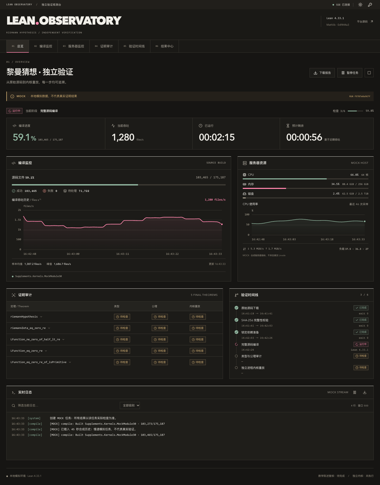
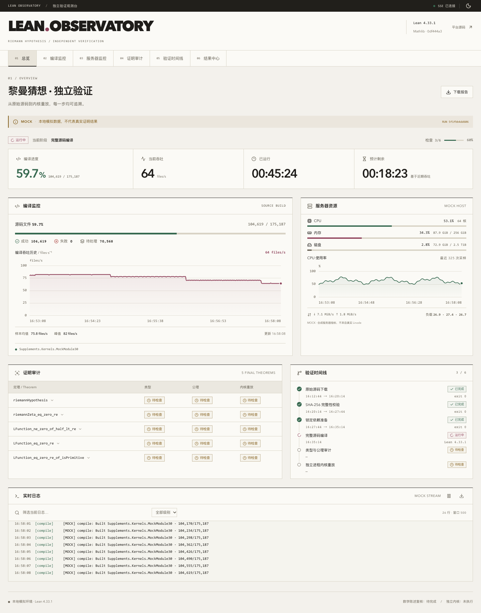

# 本地验收报告 · Lean Observatory

本文件保留购机前验收边界；后续真实部署及任务进展见 [STATUS.md](STATUS.md)。

本报告只验收平台、本地 Mock 流程及小型 Lean 工具链样例。原始黎曼猜想项目尚未下载、编译或验证。服务器尚未购买，未连接 Linode，未部署生产页面。

## 环境与验证方式

- 原生环境：macOS / ARM64、Node 26、Python 3.15；生产镜像使用 Node 24 构建、Python 3.13 API、Ubuntu 24.04 内的固定 Lean 工具链。
- 实际 Lean：4.33.1 / ARM64 原生与 AMD64 模拟容器；commit 819816b2e0a3bf405af45ae5c7af2491d8f5bee6。生产目标为 AMD64；本机模拟不是 Linode 实机验收。
- Browser plugin not available；使用本机实际 Playwright Chromium。页面为本地 API 真实渲染的 React 页面，不是静态设计截图。
- 原生浏览器测试入口 http://127.0.0.1:8788；持久的 Compose 本地预览 http://127.0.0.1:8789。
- 桌面 1600×1100、1280×900、平板 768×900、移动端 390×844、320×844；深色与浅色主题。

## 检查矩阵

| 检查 | 结果 | 证据 |
|---|---|---|
| 后端/API/安全/恢复/门禁 | 72 项通过 | unittest，实际 HTTP/SSE、SQLite、命令进程与退出码 |
| 图表计算 | 10 项通过 | 时间轴、缺测、稀疏长中断、30 分钟历史、过期屏蔽、浮层定位 |
| TypeScript / Vite 构建 | 通过 | tsc --noEmit / vite build，退出码 0 |
| 浏览器功能 | 13 项通过 | 六个页面、只读交互零写请求、CLI 驱动的暂停恢复与故障场景、下载、主题、移动导航、SSE 离线恢复 |
| 页面身份与有效内容 | 通过 | 标题/主标题/连接状态和可交互主体检查 |
| 框架错误覆盖层 | 未发现 | 生产构建页面与截图 |
| 浏览器控制台 | 无应用错误/警告 | pageerror + console error/warning 收集 |
| 响应式溢出 | 通过 | 320/390/768/1280px document.scrollWidth 检查 |
| Compose | 通过 | API、Nginx、独立 Mock Worker 实际启动并健康 |
| Nginx/SSE/只读/下载 | 通过 | 经 Nginx 实际请求；POST/PUT/PATCH/DELETE 均返回 405，旧令牌无效 |
| TLS 模板 | 配置测试通过 | 自签名本地测试证书下 nginx -t；不计为可信生产 HTTPS |
| Worker 工具链 | 小样例通过 | 固定 Lean 4.33.1 的 ARM64 / AMD64 tiny Main 编译与 fresh 内核重放 |
| 实际 Lake 全流程 | 合成小项目通过 | 原始未改 TOML + 锁定 Mathlib；14 分卷、SHA、3 模块、五类型/公理审计与 fresh Main；实际编译进程退出 42 后恢复同一任务，最终六阶段退出 0 |
| 初装、备份、线上门禁 | 本地测试通过 | Ubuntu 无 Docker 探测；默认 dry-run；SQLite WAL 一致备份；源码/镜像/资源/TLS/只读门禁的正反校验 |
| Ubuntu AppArmor profile | 语法通过 | Ubuntu 24.04 apparmor_parser 实际编译返回 0；本地不支持内核加载，enforce 必须购机后检查 |
| Worker 边界 | 通过 | UID 10002、CapEff=0、无管理令牌、数据库/应用目录不可见、源码与工具链不可写、无外网路由 |
| 子进程清理 | 通过 | 暂停进程组后强杀控制者；另测 setsid 脱离进程组子进程在私有 PID 命名空间退出后停止 |
| 完整原始日志 | 通过 | 24,001-byte 长行保留在日志 tar.gz，附事件流水与状态快照 |
| 原始 175,187 文件复现 | 未开始 | 不以平台或 tiny fixture 测试替代 |

构建器会对 lucide-react 的 `use client` 指令输出两条 module-level directive 提示；这是普通 Vite 客户端应用，无服务端组件边界，构建退出 0，实际浏览器无应用错误。这两条构建提示已记录，没有据此声称“构建输出零警告”。

Web 已按用户要求改为纯展示：删除账号/令牌入口和全部任务控制。浏览器仅 GET/SSE/下载，服务器端拒绝写方法。Mock 场景准备与任务管理均在独立命令行完成。

## 可复查的交互

入口 → SSE 连接 → Mock 编译推进 → 独立 CLI 暂停 → 浅色主题 → 五个定理详情 → 服务器/时间线/结果/编译导航 → 日志筛选 → 报告下载 → 独立 CLI 恢复 → 检查完成（仍为 MOCK）。失败、中断和资源不足分别持久化，刷新后恢复，进度不倒退；资源不足恢复会把 Lake 并发减半。浏览器断网后显示重连，联网后恢复实时状态。

原生队列还检查了 30 条历史记录之外的旧任务恢复与全量任务清单、重启后退出码未知的准确展示、HTTP 200 伪归档、哈希/路径/链接安全、公理输出伪装/冲突、缺失输出、命令失败、门禁失效及完整日志导出。

## 设计对照

用户后续指定参考 https://bandori.fans/en，已改为暖白纸面 / 暖黑主题、横向编号导航、方角细线面板、大数字与清楚的排版层级。最新实测和截图见 [UI_QA.md](UI_QA.md)，设计说明见 [THEME.md](../docs/THEME.md)。

图表全部改用按真实时间和容器像素计算的 D3 曲线；CPU/内存固定百分比尺度，磁盘为 GiB，网络下载/上传双序列区分线型。指针、触摸、方向键读数和重连均经真实浏览器验证，过期数据不补造为新样本。

## 交付边界

- 当前原始项目的五定理审计与 Main 内核重放均未执行，尚不能提供它们的真实退出码或验证结论。
- tiny fixture 使用 Lean 自身内核，不是不同实现的独立内核。公开固定镜像与锁定 Mathlib 已做定义文本核对，见 [STATEMENT_REVIEW.md](../docs/STATEMENT_REVIEW.md)；原始项目的实际常量解析与完整语义审阅仍待完成。
- 本地已构建 AMD64 API / Worker 镜像，并在模拟环境执行实际 Lean。Linode 实机环境、宿主指标、AppArmor enforce、可信 HTTPS、证书续期及线上功能必须在购机后验收，成功后才开启真实任务。
- 镜像包含可信控制进程的 SYS_ADMIN，用于隔离命名空间；被验证子进程在 chroot 内降权并清空 capabilities，不挂载 Docker socket或宿主机 PID 命名空间。
- 当前工作区 .git 只读，提交/推送通过独立临时 Git 工作目录完成，见 [GIT.md](../docs/GIT.md)。

本地源码指纹和检查退出码见 [local-acceptance.json](local-acceptance.json)。部署步骤见 [DEPLOYMENT.md](../docs/DEPLOYMENT.md)。

## 截图

