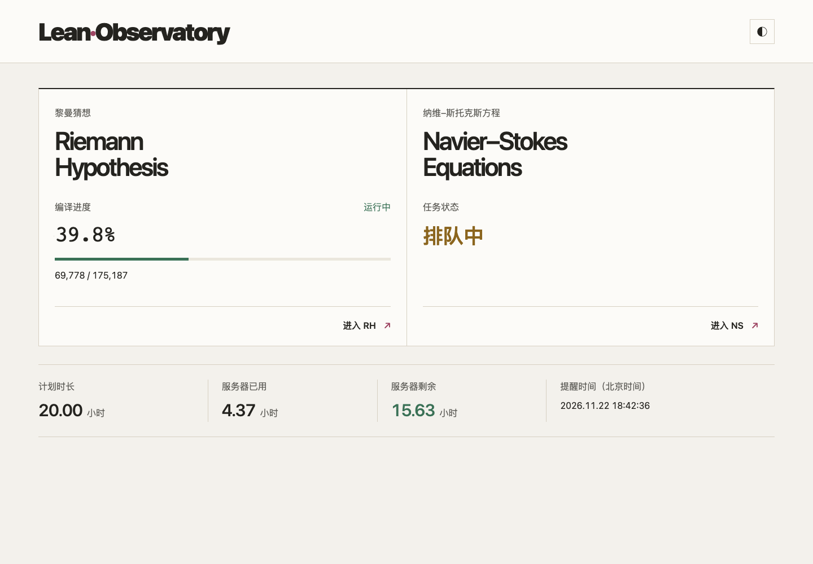
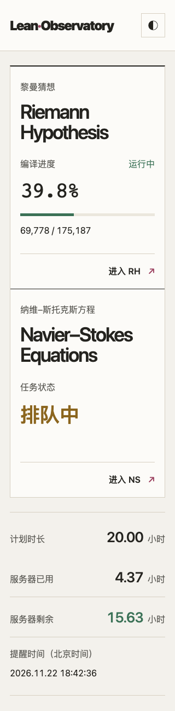

# 统一HTTPS入口与页面验收

已交付根入口与两个项目页，移除入口说明小字。RH验证进程始终保留。

| 入口 | 地址 |
|---|---|
| 项目入口 | https://lean.tano.asia/ |
| 黎曼猜想 | https://lean.tano.asia/rh/ |
| Navier–Stokes | https://lean.tano.asia/ns/ |

`lean.lanunion.org.cn`支持相同路径。80跳转443；NS原9443宿主机映射已移除，检查确认没有9443监听。内部NS Nginx保留，不对公网发布端口。

根入口只保留项目名、状态、真实进度/计数、进入链接和计时，全部可见文字至少16px。沿用现有纸白/深色主题，主题可键盘切换。NS卡片名为Navier–Stokes Equations；没有把Euler编译范围写成已完成的独立证明审计。

## 保留的运行状态

RH运行ID仍为 `20565ace60c2`。本次路由调整前已编译66,087个文件，后续采样为70,815 /175,187，失败0。原Worker、API与Nginx容器ID、PID、启动时间、镜像、命令配置、HostConfig及挂载保持。Nginx只平滑重载路由并新增NS网络连接；原Worker/API未重启，编译产物与原日志未删除。

验证上限仍为60vCPU、250GB（十进制），RH现有Lake48调度线程进程保留，NS与新任务默认60线程。NS仍QUEUED，真实验证尚未执行。RH全部必要检查成功、最终结果与完整日志校验归档后，NS自动启动；20小时及资源预检仅告警，不因到时或预检不足停止自动衔接。

计时起点2026-11-21T14:42:36Z，20小时节点为北京时间2026-11-22 18:42:36。起点没有因部署或服务重启重置，到时保持运行，由管理员判断停止。

## 路由与上线检查

- 根入口由独立只读服务提供；`/rh/`转发到原RH应用，原`/api`和`/assets`保留兼容；NS请求限定在`/ns/api`和`/ns/assets`。
- 使用唯一完整后端名消除两个Docker网络的`api`别名冲突。
- 原挂载Nginx配置先备份，再用原可信镜像和只读证书验证，在原inode写入并平滑重载；失败可恢复配置和新加网络。已补充并实际验证检查容器必需的CHOWN权限。
- 初次连接时等待Docker DNS解析就绪；共享443路径实际通过后才重新创建NS自己的Nginx以撤下9443映射。
- 两个域名公网HTTPS证书验证成功。真实浏览器完成入口→RH、入口→NS、NS返回入口；SSE与报告下载通过，无脚本错误或写请求。
- API与Worker的原部署文件未更换；仅原Nginx运行配置被授权更新。运行覆盖文件和备份位于`/opt/lean-observatory/.data/ops/`。

## QA Evidence

- Rubric score: **15/16**。
- Surface inspected: 本地及生产浏览器、桌面/手机截图。
- Viewports: 本地1440/1280/768/390/320；生产1440/390/320。
- Interaction: 项目跳转、主题与键盘、真实数据更新、断线重连、过期心跳、下载和只读请求。
- Commands: 175项Python测试、10项图表测试、13项RH浏览器测试、NS/入口浏览器、真实本地Nginx隔离与验证容器测试、资源配置、构建与语法检查全部通过。完整命令与原始日志见`ns-local-acceptance.json`与`ns-local/`。
- 审计方式: 语义HTML、焦点、键盘和浏览器布局人工/自动核对；未单独运行启发式静态设计脚本。
- Revision loop: 修复手机顶部换行、平板对齐、CSP图标；按用户要求删除全部入口小号说明并重检。
- Remaining gaps: 尚未进行真实NS源码验证、外部独立工具兼容性检查，待RH成功后实际执行；没有宣称任何证明通过。

代码提交 `17f089a`；NS部署源码SHA-256 `aee6954722e0ac13c014827ba52c62f8566e3e4e3ea101555d60b2127f9f7f6e`；发布包SHA-256 `5b20325365a13da6b96e68ee44b1d3c207f2e064501067ad936a9bb118dc3902`。

结构化核对见`shared-https-live.json`及前后RH快照。`proofAccepted=false`。
